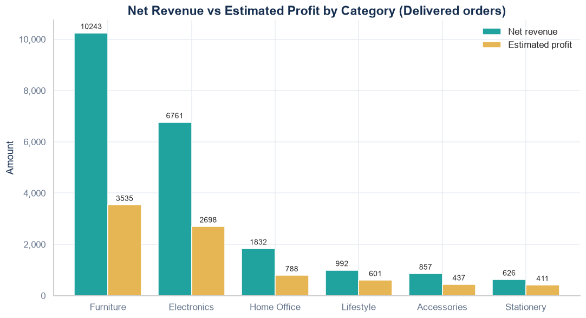
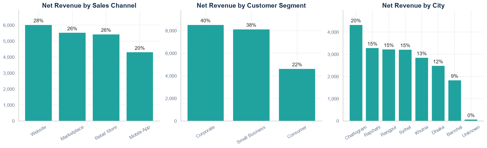
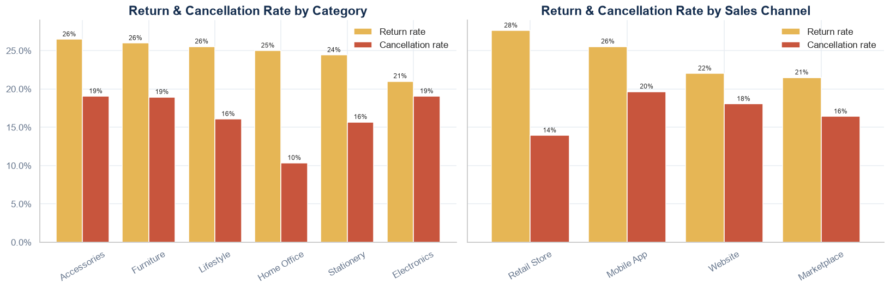

# Retail Sales Analysis

Python data-analysis project on 500 retail orders: cleaning messy data, measuring the revenue the business actually keeps, and finding where it is lost.

**Tools:** Python, pandas, NumPy, matplotlib, seaborn, Jupyter

## Business questions
1. How much revenue and profit remain after cancelled and returned orders are removed?
2. Which categories, products, channels, customer segments and cities drive revenue?
3. Where are returns and cancellations concentrated?
4. How does revenue change month to month, and how loyal are customers?

## Dataset
- File: `retail_sales_raw_dataset.csv` (503 raw rows, 16 columns, orders placed in 2025)
- Source: `retail_sales_raw_dataset.csv`, included in this repository
- Currency: not stated in the data
- Limitations: small sample (500 orders); cost is an estimate, so profit is an estimate

## Data cleaning (what and why)
| Problem found | Fix |
|---|---|
| 3 exact duplicate rows | Removed, so no order is counted twice |
| Same label spelled differently (`furniture` / `Furniture`, `Website ` / `Website`, `dhaka ` / `Dhaka`, `delivered` / `Delivered`) — 14 values | Trimmed spaces and unified spelling in every text column |
| Missing `city` / `payment_method` | Labelled `Unknown` |
| Missing `unit_price` (3) | Filled from the product's fixed price |
| Missing `quantity` (3) / `discount_pct` (4) | Recovered exactly from the recorded revenue |
| Revenue defined two ways | One definition used throughout: `quantity x unit_price x (1 - discount)`; matches recorded revenue on 100% of rows |

## Key results
| Metric | Value |
|---|---:|
| Orders placed | 500 |
| Gross order value (all orders) | 35,408 |
| **Net revenue (Delivered only)** | **21,310** |
| Value lost to returns and cancellations | 39.8% |
| Estimated profit / margin | 8,470 / 39.7% |
| Return rate / cancellation rate | 24.1% / 17.0% |
| Customers with 2+ delivered orders | 55.1% |

## Findings
- **Counting every order overstates revenue by about 66%.** Returned and cancelled orders make up 39.8% of order value, so only 21,310 of 35,408 was kept.
- **Furniture** is the largest category (48% of net revenue) but has the lowest margin (about 35%). Stationery has the best margin (66%) but is a very small share of revenue.
- **Return rates are high everywhere** (roughly 21-26% by category), so the cause is likely in the whole order and delivery process, not one product line. Retail Store has the highest channel return rate (27.6%).
- **Revenue is uneven month to month**, peaking in August (3,301) and lowest in June (950).
- The top 10% of customers generate 37% of net revenue.

## Recommendations
1. Investigate the order/delivery process behind returns, since no single category explains them.
2. Review Furniture pricing and costs: it is half of revenue at the weakest margin.
3. Reward repeat buyers and win back one-time buyers.
4. Break down cancellations by channel to find stock, payment or delivery causes.

## Charts
**Net revenue vs estimated profit by category**



**Net revenue by channel, customer segment and city**



**Return and cancellation rates**



## How to run
```bash
pip install pandas numpy matplotlib seaborn jupyterlab
jupyter lab
```
Open `Retail_Sales_Analysis_Final.ipynb` and choose **Kernel > Restart Kernel and Run All Cells**. Keep `retail_sales_raw_dataset.csv` in the same folder as the notebook.

## Files
- `Retail_Sales_Analysis_Final.ipynb`: full analysis
- `retail_sales_raw_dataset.csv`: raw data
- `retail_sales_cleaned.csv`: output of the cleaning step
